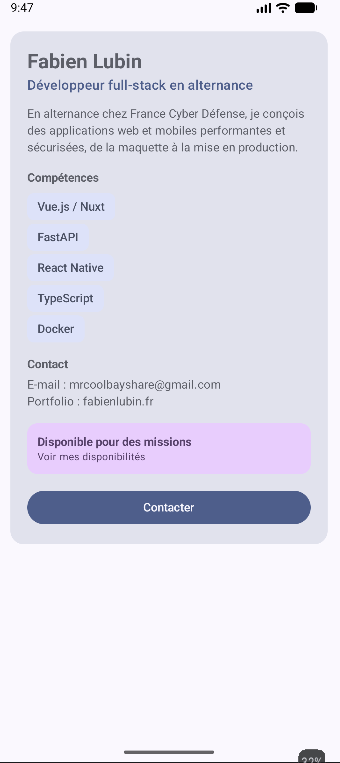

# Profil développeur Compose

## Description

Cette application Android affiche ma fiche « Profil développeur » (Fabien Lubin, développeur full-stack en alternance), réalisée avec Jetpack Compose.
L'écran présente le nom, le rôle, une courte description, une liste de compétences, un e-mail, le lien vers mon portfolio et ma disponibilité.
Deux actions sont proposées : une zone cliquable « Disponible pour des missions » et un bouton « Contacter ».
Le clic est transmis au parent par un callback : il n'y a pas de logique applicative derrière, seulement un commentaire.
L'interface est découpée en petits composables réutilisables, alimentés par des paramètres.

## Notions utilisées

- composables (`@Composable`) ;
- paramètres ;
- modifiers (`Modifier`, `padding`, `fillMaxWidth`, `clickable`, `semantics`) ;
- chaînage de modifiers ;
- padding externe / interne ;
- callbacks (`onClick: () -> Unit`) ;
- `Scaffold` et `innerPadding` ;
- previews (`@Preview`) ;
- accessibilité de base (`Role.Button`, `contentDescription`, `onClickLabel`).

## Explication courte

**1. Quels composables avez-vous créés ?**
`EcranProfil`, `FicheProfil`, `EnTeteProfil`, `TitreSection`, `Competence`, `InformationSecondaire`, `ZoneDisponibilite` et `BoutonAction`, plus deux previews : `ProfilFullStackPreview` (mon profil, disponible) et `ProfilAndroidJuniorPreview` (profil fictif, non disponible, avec d'autres compétences).

**2. Quel composable représente l'écran principal ?**
`EcranProfil`. Il est appelé dans `MainActivity`, à l'intérieur du `Scaffold`.

**3. Où utilisez-vous un padding externe ?**
Dans `EcranProfil`, qui place la fiche avec `Modifier.padding(16.dp)` : c'est le parent qui choisit la marge autour de `FicheProfil`.
On en trouve aussi dans `FicheProfil`, qui espace les éléments les uns des autres (par exemple `Modifier.padding(top = 16.dp)` passé au `BoutonAction`).
Enfin, le `innerPadding` du `Scaffold` est appliqué de l'extérieur à `EcranProfil` pour éviter les barres système.

**4. Où utilisez-vous un padding interne ?**
Dans `FicheProfil`, le `Column` placé dans la `Surface` reçoit `padding(20.dp)` : le contenu est écarté des bords de la fiche.
On en trouve aussi dans `Competence` (`padding(horizontal = 12.dp, vertical = 6.dp)` autour du texte de l'étiquette) et dans `ZoneDisponibilite` (`padding(12.dp)`).

En résumé : le padding externe est décidé par le parent via le paramètre `modifier`. Il place le composant dans l'écran.
Le padding interne est décidé par le composant lui-même. Il espace son propre contenu.

**5. Quel composant reçoit un callback ?**
`BoutonAction` reçoit `onClick` et `ZoneDisponibilite` reçoit `onClick`.
Ces callbacks remontent jusqu'à `EcranProfil` (`onContacterClick`, `onDisponibiliteClick`), puis jusqu'à `MainActivity`, qui fournit des fonctions vides commentées.
Les composants signalent l'événement mais ne décident pas de ce qui se passe.

**6. Quelle information d'accessibilité avez-vous ajoutée ?**
`ZoneDisponibilite` est une zone cliquable personnalisée (une `Surface` avec `clickable`). Elle déclare :
- `role = Role.Button` : le lecteur d'écran l'annonce comme un bouton ;
- `onClickLabel` : il décrit l'action, par exemple « Voir mes disponibilités » ;
- `semantics { contentDescription = ... }` : il fournit une phrase claire pour TalkBack.

Le bouton « Contacter » utilise un `Button` : ce composant expose déjà son rôle de bouton et son texte aux outils d'accessibilité. Il n'a donc pas besoin d'informations supplémentaires.

**7. Pourquoi vos composants peuvent-ils être considérés comme réutilisables ?**
Ils reçoivent leurs données par des paramètres (nom, rôle, compétence, texte du bouton, disponibilité, callbacks) au lieu de les écrire en dur.
Ils acceptent aussi un `modifier: Modifier = Modifier`, ce qui permet au parent de décider de leur placement.
Par exemple, `Competence` est appelé une fois par compétence de la liste, et `InformationSecondaire` sert à la fois pour l'e-mail et pour le portfolio. Les deux previews affichent deux profils différents avec les mêmes composables.

## Capture

Application lancée sur un émulateur :

## Lancer le projet

1. Ouvrir le dossier dans Android Studio.
2. Laisser la synchronisation Gradle se terminer.
3. Ouvrir `app/src/main/java/com/example/profildeveloppeur/ProfilDeveloppeur.kt` en mode *Split* ou *Design* pour voir les previews, ou lancer l'application sur un émulateur.
